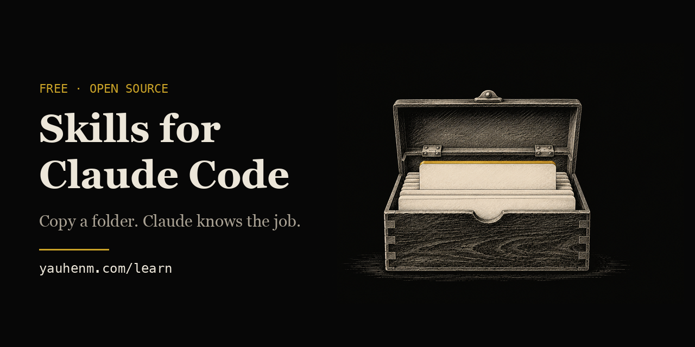

# Skills for Claude Code



**Free skills that teach Claude Code one job each. Copy a folder, and Claude knows the job.**
Made by Yauhen Massalski. Each skill has a free 15-minute lesson on [yauhenm.com/learn](https://yauhenm.com/learn/).

| Skill | What it does | Free lesson |
|---|---|---|
| [podcast-notes](podcast-notes) | Turns any podcast episode into clear notes on one page | [Notes from any podcast](https://yauhenm.com/learn/podcast/1/) |
| [web-qc](web-qc) | Checks a web page on a phone and a computer before you share it | [Check it on a phone](https://yauhenm.com/learn/phone-check/1/) |
| [loop-spec](loop-spec) | Plans an AI job that repeats, with a finish line it can check | [Give AI a finish line](https://yauhenm.com/learn/goal/1/) |
| [write-a-skill](write-a-skill) | Helps Claude write a new skill the right way | [Teach AI a task one time](https://yauhenm.com/learn/skills/1/) |

**Good skills by other people.** I use these every day. Get them from the original author:

| Skill | What it does | Original | Free lesson |
|---|---|---|---|
| stop-slop | Removes typical AI writing habits from text | [hardikpandya/stop-slop](https://github.com/hardikpandya/stop-slop) | [Make AI write like you](https://yauhenm.com/learn/voice/1/) |
| last30days | Finds what people said about a topic this month | [mvanhorn/last30days-skill](https://github.com/mvanhorn/last30days-skill) | [What are people saying?](https://yauhenm.com/learn/last30days/1/) |
| grilling | Asks you hard questions about a plan until it holds up | [mattpocock/skills](https://github.com/mattpocock/skills) | [Let AI question your plan](https://yauhenm.com/learn/grill/1/) |

**Words you need.** *Claude Code* is Anthropic's app that lets Claude work on your computer. A *skill* is a folder with a `SKILL.md` text file. Claude reads it when your request matches the job.

## Install any skill

Every skill is a folder. To install it, copy the folder into `~/.claude/skills/`.
Read the README inside the skill's folder first. Some skills need extra tools.

### Step 1: get the files

If you have Git:

```bash
git clone https://github.com/holl4ndtv/skills.git ~/skills
```

No Git? On the GitHub page, click the green **Code** button, then **Download ZIP**.
Unzip it. On a Mac, move the unzipped folder to your home folder and rename it `skills`.
On Windows, move it to `C:\Users\<your name>\skills`.

### Step 2: copy one skill folder

Mac (Terminal app):

```bash
mkdir -p ~/.claude/skills
cp -R ~/skills/web-qc ~/.claude/skills/
```

Windows (PowerShell):

```powershell
New-Item -ItemType Directory -Force "$env:USERPROFILE\.claude\skills"
Copy-Item -Recurse "$HOME\skills\web-qc" "$env:USERPROFILE\.claude\skills\"
```

Replace `web-qc` with the skill you want.

### Step 3: restart Claude Code and test

Close Claude Code and open it again. Type the test phrase from the skill's README.

### Or ask Claude Code to do it

Open Claude Code and type:

> Install this skill from https://github.com/holl4ndtv/skills/tree/main/web-qc

Claude will fetch the folder and put it in `~/.claude/skills/`. Then read the skill's README for any extra tools.

## Learn more

Free lessons for each skill: [yauhenm.com/learn](https://yauhenm.com/learn)

## License

MIT for my own skills (see [LICENSE](LICENSE)). Work from other authors keeps its own license. See [CREDITS.md](CREDITS.md).
